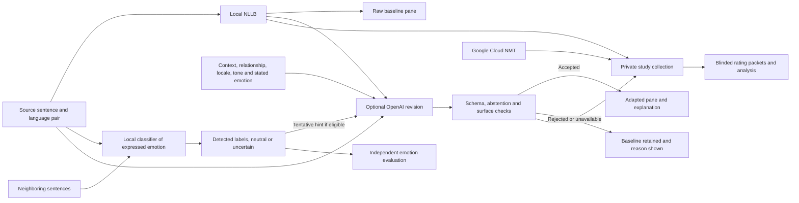
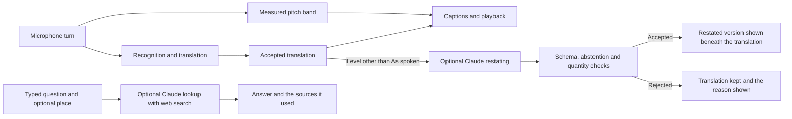

# Click

A noncommercial research prototype for academic review. The research question is whether a context-aware revision of an NLLB draft better preserves the speaker’s tone and communicative intent while retaining the meaning of the source sentence.

Click is the application built on that research prototype. Three capabilities sit on top of it. **Spoken translation** carries the speaker’s delivery into the other language, matching pitch, pace, emphasis and vocal range, and optionally cloning the voice itself. **Explain at another level** restates an accepted translation for a different listener, from short everyday words to a professional register, which matters when a direct translation is accurate but the terminology is not understood. **Ask about where you are** answers a practical question about an unfamiliar place or institution, searching the web when current or local facts would change the answer, and repeats that answer in any configured language or reads it aloud. The second and third features are additive and optional: they never alter the translation itself, and the recorded study path is unchanged.

Use the [launch guide](START_HERE.md) to run the interpreter and the [publishing guide](PUBLISH.md) to share the reviewer walkthrough through GitHub Pages.

## Run locally

Use Python 3.11 on a platform with PyTorch wheels. The default device is CPU. Model setup needs several GB of disk space and working memory. The first translation downloads the pinned Meta checkpoint, which can take several minutes.

```sh
python3 -m venv .venv
source .venv/bin/activate
python -m pip install -r requirements.txt
python app.py
```

Open [the local Gradio app](http://127.0.0.1:7860). The main screen starts a live conversation, and **Text and file tools** opens the sentence workflow. **Analyze wording only** uses the separate pinned text classifier. The intended-emotion field and surrounding text are optional. Use `python app.py --no-emotion` to disable emotion labels and caption cues. Set `HF_HUB_OFFLINE=1` to use an existing model cache without network access. To inspect the interface with fixed examples before downloading weights, run `python app.py --demo`. The fixture supports one English sentence with Spanish, Greek and Japanese targets. You can install just `gradio==5.49.1` in a separate environment for fixture mode.

To enable adaptation, set `OPENAI_API_KEY` in the shell that starts the app, preferably through a secret manager or a hidden prompt. Restart the app after setting it. For example, in zsh:

```sh
read -rs 'OPENAI_API_KEY?OpenAI API key: '
export OPENAI_API_KEY
printf '\n'
python app.py
```

The per-request checkbox opts in to sending the sentence, context, preferences, NLLB draft and any accepted emotion hints to OpenAI. The default model is `gpt-4.1-mini`, which supports the Responses API and Structured Outputs. `TRANSLATION_LLM_MODEL` can select an account-accessible model with the same schema and sampling parameter support. The study records both requested and returned model IDs. Pin a supported dated snapshot if available to your account, and record any model substitution as a protocol amendment. [Official OpenAI model documentation](https://developers.openai.com/api/docs/models/gpt-4.1-mini) · [Structured Outputs](https://developers.openai.com/api/docs/guides/structured-outputs)

The restating and lookup features use a separate `ANTHROPIC_API_KEY` and the pinned `anthropic` client in `requirements-assistant.txt`. They are hidden entirely when no credential is present, and `--no-assistant` disables them even when one is. `ASSISTANT_LLM_MODEL` can select another account-accessible Claude model. See [Explain at another level](#explain-at-another-level) and [Ask about where you are](#ask-about-where-you-are) for what each request sends.

The study runner uses a separate `GOOGLE_TRANSLATE_API_KEY` only with `--google`. Restrict credentials to the appropriate API and use project-level budgets. The app binds to loopback, disables public sharing and Gradio analytics, and never returns credentials to the browser. The OpenAI request sets `store=false`. Provider data handling still applies. Use synthetic or consented, redacted sentences in both services. Keep run directories, outputs, and blinding keys private. [OpenAI data controls](https://developers.openai.com/api/docs/guides/your-data)

## Architecture



The two added features branch off the accepted translation rather than passing through it.



The restating never replaces `C`, and the lookup has no input from it, so neither can change what the study records.

`translation.py` runs NLLB with explicit source/target tokens and deterministic beam decoding. `adaptation.py` builds a closed JSON contract for revisions. `validation.py` rejects invalid fields, abstentions, empty candidates, control characters and changes to visible numbers or URLs. `pipeline.py` owns the decision and preserves the baseline for fallback. “Literal baseline” is the UI label for raw NLLB, which is a learned translation and may use idioms or paraphrase.

`assistant.py` holds the optional Claude client for the restating and lookup features. It is reached only from its own handlers, never from `pipeline.py`, so no study output depends on it. `prosody.py` measures the speaker’s absolute pitch for voice selection in one function that the classifier features never read.

`emotion.py` runs a trained classifier on the original source text. It scores 27 affect labels and a neutral category, can return several labels, and can abstain. It also compares the sentence alone, the sentence with its context, and the context alone when surrounding text is supplied. The latter comparison helps flag cases where a signal may come from a neighboring speaker. The model runs locally on CPU. Its scores are uncalibrated. The intended-emotion field is a separate speaker annotation and takes priority when supplying a hint for adaptation. Locale is an optional language-variety preference. The revision prompt asks the model to preserve uncertainty, avoid stereotypes, and explain its wording choices. Its adequacy estimate is separate from the detector's scores.

The classifier uses human-labeled English GoEmotions comments and machine-translated training examples in Spanish, Greek, Japanese and other languages. This supports an initial four-language experiment. Real-world accuracy, culturally specific affect, speaker attribution and sarcasm require separate evaluation. [Classifier model card](https://huggingface.co/Horizon-Labs/multilingual-emotions-small) · [GoEmotions research paper](https://aclanthology.org/2020.acl-main.372/)

The app configures 12 languages and 132 ordered translation directions. The original study pilot covers the 12 directions among English, Spanish, Greek, and Japanese. To add a language, register its NLLB code, recognition code, and locales in `pragmatics/config.py`, add voice mappings and localized caption cues, then verify each direction. Bilingual evaluation determines where the system is suitable. Locale fidelity, names, negation, implied commitments and cultural nuance can fail even when surface checks pass. Numeric checks can reject valid formatting changes and can miss reordered or semantically changed quantities. The prototype handles sentence-length general-domain research material. Meta lists the checkpoint under **CC BY-NC 4.0** and describes it as a research model. Review the terms for the intended use before redistribution or deployment. [Meta model card](https://huggingface.co/facebook/nllb-200-distilled-600M)

## Verify and evaluate

```sh
python -m unittest discover -v
RUN_NLLB_SMOKE=1 python -m unittest tests.test_live.LiveChecks.test_nllb -v
RUN_EMOTION_SMOKE=1 python -m unittest tests.test_live.LiveChecks.test_emotion -v
RUN_OPENAI_SMOKE=1 python -m unittest tests.test_live.LiveChecks.test_openai -v
RUN_GOOGLE_SMOKE=1 python -m unittest tests.test_live.LiveChecks.test_google -v
```

The default suite exercises the pipeline and study code with fixtures and mocks. Gradio construction runs when the dependency is installed. The paid checks require their respective keys. The local model checks download or read the pinned weights. For an emotion-only evaluation environment, install `requirements-emotion.txt`. For the restating and lookup features, install `requirements-assistant.txt`. The default suite covers both with recorded request shapes and a fake client, so it needs no key. Direct dependencies and the model revision are pinned. For a frozen study, save the complete environment from the successful install with `python -m pip freeze > runs/environment.txt` after creating `runs`, and retain the platform and hardware details.

```sh
# Local-only pilot
python -m study.run study/data/pilot.jsonl runs/local-pilot

# Full pilot with paid services and ablations
python -m study.run study/data/pilot.jsonl runs/full-pilot --openai --google --ablations
python -m study.blind study/data/pilot.jsonl runs/full-pilot runs/packets --seed 738418

# After raters return completed CSVs
python -m study.analyze runs/full-pilot/outputs.jsonl runs/packets/PRIVATE_key.jsonl \
  runs/packets/rater_1.csv runs/packets/rater_2.csv runs/packets/rater_3.csv
```

The packaged 12-item synthetic dataset exercises every initial direction once. It is intended for piloting collection and scoring. Review [the study protocol](study/PROTOCOL.md), [rater instructions](study/RATER_GUIDE.md) and [dataset notes](study/data/README.md) before collecting benchmark ratings.

## Evaluate emotion detection independently

```sh
mkdir -p runs
python -m study.emotion_eval study/data/emotion-pilot.jsonl > runs/emotion-pilot.json
```

The evaluator measures how well the classifier matches proposed labels when it sees the sentence alone and when surrounding text is available. It reports per-language and per-label scores, coverage, uncertainty on ambiguous items, and whether both sides of each matched context pair are correct. The command uses local inference after downloading the checkpoint. See [the emotion evaluation protocol](study/EMOTION_PROTOCOL.md) for the pilot results and the design for independent review.

## Speak and hear a translation on macOS

Choose the source and target languages. Open **Text and file tools** to upload an existing recording. Uploaded files translate automatically. The transcript is editable. Use **Translate text and speak** to replay a corrected transcript. The **Swap languages** button prepares the reverse direction for the next speaker. If autoplay is blocked, press play on **Spoken translation**.

The app uses local Whisper Base to transcribe up to two minutes in the selected source language, runs the sentence translation workflow, then plays the adapted translation when accepted or the NLLB version otherwise. Playback uses installed macOS voices. If a voice is unavailable, check **System Settings → Accessibility → Read & Speak** for installed voices. Captions are also available on hosts that lack a system voice.

Recordings and synthesized audio are processed locally. Gradio holds temporary copies for playback of uploaded recordings and removes aged files periodically. Enabling the optional OpenAI revision sends text and translation metadata, including the transcript. The optional revision can receive a strong acoustic estimate as a tentative hint. Short-clip transcription can mishear words, names, or numbers. Review the transcript before relying on the translation. [Whisper model card](https://huggingface.co/openai/whisper-base)

## Live conversation and private hosting

Choose two languages and select **Start listening** once. **Two-way interpreter** identifies the language of each turn and translates into the other selected language. During audio playback in two-way mode, the microphone pauses capture to avoid interpreting the app's own voice and resumes automatically afterward. Very short, noisy, or mixed-language turns can be ambiguous. Turn off **Two-way interpreter** to set a fixed direction.

The large **Live captions** panel shows the translation and original transcript. Longer speech gets rolling draft captions as you talk. After a pause, the full turn replaces the draft and appears in **Conversation**. The default pause is 0.75 seconds of detected quiet. Choose **0.5 seconds · quick** for tighter turn-taking, or one, five, seven, or ten seconds for more room between clauses. **Captions only** keeps playback silent. Selecting the same language on both sides gives a transcript. **Show captions** controls the large panel.

For short local turns, the app can start processing after a quarter second of quiet. It holds the caption and audio until the selected pause confirms the turn. Resuming speech discards the early result. [Dialogue latency pilot](study/DIALOGUE_LATENCY.md)

**Voice range** defaults to **Match speaker**. See [Match the speaker’s voice range](#match-the-speakers-voice-range). **Understanding help** holds the explanation level and the lookup panel, and appears only when a Claude credential is present.

**Spoken tone** defaults to **Match delivery**. Select **Warm**, **Calm**, **Excited**, **Firm**, or **Formal** to guide playback for the current turn. The intended tone is an explicit setting, and the app's acoustic measurements are a separate input. In **Conversation context**, the relationship and situation guide a small local catalogue of complete idiom phrases and register choices. For example, “Break a leg” with “before an audition” is interpreted as a wish for good luck. The local catalogue covers selected phrases. When the app is launched locally with `OPENAI_API_KEY`, the optional OpenAI checkbox enables broader contextual revision for short turns and sends the transcript, draft, context, and preferences. It can add delay. If revision fails or abstains, the app uses the local wording.

The live language choices are English, Spanish, Greek, Japanese, French, German, Italian, Portuguese, Dutch, Mandarin Chinese with Simplified text, Korean, and Standard Arabic. Vocal cue captions use the selected output language. The controls are in English. Speech recognition and translation quality vary by language, dialect, and recording conditions. [Whisper language coverage](https://github.com/openai/whisper#available-models-and-languages) · [NLLB model card](https://huggingface.co/facebook/nllb-200-distilled-600M)

The [speech-to-English pilot](study/INBOUND_QUALITY.md) separates wrong language routing, transcription errors, and translation errors. It reports results for every offered non-English language and documents the Greek caption regression.

Drafts use at most the latest eight seconds of captured audio and can revise words or begin partway through a thought. **Turn mic off** releases the microphone and finishes any buffered speech. Each turn supports up to two minutes. At the limit, the app stops recording and translates what it captured. Background sounds can extend the detected pause. Up to two turns can process concurrently, and playback keeps their original order. Live speech uses greedy NLLB decoding. Reviewed, complete Greek and Spanish expressions of thanks have fixed English wording in live captions and playback. The text study uses four-beam NLLB decoding. In Chrome, use the browser’s install option to add a standalone app window.

**Expressive voice** adjusts system voice pitch and pace from the original recording. **Match my voice · AI-generated** is an opt-in mode for the live microphone on a configured Apple Silicon Mac. It uses up to the first ten seconds of each turn as a reference for speaker likeness and delivery. It sets Chatterbox expressiveness using measurements from the recording. Both modes follow broad shifts in emphasis with a bounded loudness curve. Use voice matching with your own voice or with the speaker’s permission. The reference is processed in memory on the host. The app plays the expressive voice if matching fails, the reference is shorter than a second, or the translation exceeds 500 characters. Evaluate resemblance and emotional fidelity with listeners. [Chatterbox model and license](https://github.com/resemble-ai/chatterbox) · [MLX Audio implementation](https://github.com/Blaizzy/mlx-audio/blob/main/docs/models/tts/chatterbox.md)

For a consistent voice reference across turns, open **Personal voice profile** with the live mic off. Select the language you speak and press **Record my voice**. Speak naturally for the nine-second recording. Once the sample is ready, leave **Playback voice** on **Match my voice** and **Spoken tone** on **Match delivery**, then start the live mic. The profile anchors speaker characteristics for matching turns in the assigned language. The current turn guides delivery, including broad changes in emphasis and a modest pace adjustment. The conversation marks playback that used the profile. The sample stays in the tab between turns and the host processes it in memory for matching. **Clear sample** and refreshing the page remove it from the tab.

### Faster playback and voice matching on Apple Silicon

With the base environment active, install the optional speech recognizer and translation runtime. The latter converts the pinned NLLB checkpoint to 8-bit weights for spoken turns. The voice-matching environment is separate because its dependencies use a newer model stack. Use a macOS version supported by the pinned MLX wheel. The initial downloads require network access and additional disk space. Build the resident system voice renderer with Apple's Command Line Tools. [CTranslate2 NLLB conversion](https://opennmt.net/CTranslate2/guides/transformers.html#nllb)

```sh
python -m pip install -r requirements-apple.txt
hf download mlx-community/whisper-large-v3-turbo-4bit config.json model.safetensors \
  --revision 0f058d38170d183f9fdee07908f5b515d91793a8

nllb_source="$(hf download facebook/nllb-200-distilled-600M \
  --revision f8d333a098d19b4fd9a8b18f94170487ad3f821d \
  --include config.json generation_config.json pytorch_model.bin 'tokenizer*.json' \
    sentencepiece.bpe.model special_tokens_map.json)"
mkdir -p .voice-engine
ct2-transformers-converter --model "$nllb_source" --output_dir .voice-engine/nllb-int8 --quantization int8

python -m venv .voice-engine
.voice-engine/bin/python -m pip install -r requirements-voice-match.txt
.voice-engine/bin/hf download mlx-community/chatterbox-4bit \
  config.json model.safetensors model.safetensors.index.json conds.safetensors tokenizer.json Cangjie5_TC.json \
  --revision f1d7b9696e1b6242e64eb8c4a823b6d1a50425a8
.voice-engine/bin/hf download mlx-community/S3TokenizerV2 config.json model.safetensors
swiftc -O pragmatics/native_voice.swift -o .voice-engine/native-voice

OMP_NUM_THREADS=4 python app.py --warm --whisper-turbo \
  --fast-nllb "$PWD/.voice-engine/nllb-int8" \
  --native-voice "$PWD/.voice-engine/native-voice" \
  --voice-engine "$PWD/.voice-engine/bin/python"
```

The worker checks that the speech tokenizer's cached `main` ref resolves to `e0c9886f0e1c35ae85b1f27277416fb19fc72bec` and synthesizes offline. `--warm` starts loading models when the app opens. `--whisper-turbo` runs multilingual recognition from the pinned local cache. It shares one audio encoding between language detection and transcription for turns up to 30 seconds. For the lighter Whisper Base profile, download `mlx-community/whisper-base-mlx` files `config.json` and `weights.npz` at revision `1e3e249fb8d01c655324bd6841b1deadffd6d04c` and launch with `--fast-whisper`. `--fast-nllb` enables the converted 8-bit checkpoint for speech. Check translation adequacy before comparing these runs with the original precision study baseline. `--voice-engine` adds voice matching alongside captions and the available system voice. The system renderer defaults to `say` on Mac or eSpeak NG on Linux. [MLX Whisper package](https://pypi.org/project/mlx-whisper/) · [Pinned Chatterbox checkpoint](https://huggingface.co/mlx-community/chatterbox-4bit/tree/f1d7b9696e1b6242e64eb8c4a823b6d1a50425a8) · [Pinned speech tokenizer](https://huggingface.co/mlx-community/S3TokenizerV2/tree/e0c9886f0e1c35ae85b1f27277416fb19fc72bec)

```sh
RUN_SPEECH_SMOKE=1 WHISPER_TURBO=1 FAST_NLLB_MODEL="$PWD/.voice-engine/nllb-int8" \
  NATIVE_VOICE="$PWD/.voice-engine/native-voice" python -m unittest tests.test_live.LiveChecks.test_spoken_languages -v
VOICE_ENGINE="$PWD/.voice-engine/bin/python" python -m unittest tests.test_live.LiveChecks.test_voice_match -v
VOICE_ENGINE="$PWD/.voice-engine/bin/python" NATIVE_VOICE="$PWD/.voice-engine/native-voice" \
  python -m unittest tests.test_live.LiveChecks.test_personal_voice_profile -v
```

For a private browser URL that works while your Mac is off, see [Private hosting](HOSTING.md). The repository includes the container configuration and password gate. Hosting changes where speech is processed and uses the container’s speech synthesizer.

### Vocal emotion

Live captions include timestamped vocal cues such as **Pitch rises**, **Voice gets softer**, and **Rhythm quickens**. The cue analysis compares adjacent voiced parts of the original waveform. Whisper produces the words on a separate path. The speech classifier's development results fall below the evidence rule for displaying named emotions, so the current model abstains. Typed text has a separately labeled wording analysis. The voice study includes a reproducible false-alarm benchmark and a blinded playback protocol. [Voice model and held-out evaluation](study/VOICE_MODEL.md)

## Match the speaker’s voice range

System voices are fixed per locale, so a lower-pitched speaker was previously played back in whichever voice the locale listed. **Voice range** now offers **Match speaker**, **Language default**, **Lower pitch** and **Higher pitch**.

Matching measures the median voiced fundamental frequency of the turn and places it in a band. A measurement at or below 152 Hz selects a lower-pitched voice and one at or above 182 Hz selects a higher-pitched one. Measurements between those thresholds, where adult speaking ranges overlap, select nothing and the locale default is kept. Turns with less than about a third of a second of voiced audio are not measured.

**This reports a pitch band and nothing else.** It is not a claim about a speaker’s gender or identity, no such label is ever displayed or sent anywhere, and the manual settings override the measurement whenever it is wrong. Pitch overlaps heavily between speakers, so treat the automatic choice as a convenience.

On macOS the app reads the installed voices with `say -v '?'` and takes the first candidate present for the band, falling back through the remaining candidates to the locale default, so an absent voice never costs playback. On other platforms eSpeak NG renders the band as a speaker variant of the same language voice. **Match my voice · AI-generated** already reproduces the speaker’s own voice and ignores this setting.

Absolute pitch is read in exactly one function and is deliberately excluded from the emotion feature vector, which keeps using clip-relative pitch only. The published voice model and its held-out evaluation are therefore unchanged. A regression test asserts that two recordings an octave apart produce the same classifier features while reporting pitches 110 Hz apart.

## Explain at another level

A direct translation can be accurate and still not land, because the speaker used terminology, phrasing, or a register the listener does not share. **Explanation level** restates an accepted translation for a different listener:

| Level | Written for |
| --- | --- |
| **As spoken** | The translation is shown unchanged. This is the default and makes no request. |
| **Simple** | A listener who wants very short sentences and everyday words. |
| **Plain** | An adult with no training in the subject, at about a high-school reading level. |
| **Detailed** | An attentive adult who wants every technical term kept and briefly explained. |
| **Technical** | A trained professional who expects precise terminology. |

The original translation is always kept and displayed. The restated version appears beneath it, with a glossary of the specialist terms involved and a note naming any nuance the simpler wording loses. In the live panel any level other than **As spoken** restates each completed turn; captions and audio are released first and the restating runs beside playback, so it adds no delay to either. **Explain at another level** in the text tools restates a sentence on demand.

The request sends the translation, the original transcript, the selected audience and the situation field. The prompt requires the meaning, speaker, negation, modality, commitments and conditions to be preserved, forbids adding any fact, recommendation or reassurance that is not in the input, and forbids removing a warning, risk or instruction the speaker gave. Quantities and units must be carried over exactly. The model abstains when it cannot restate the turn faithfully at the requested level, and the app then keeps the translation and says so.

Because a simpler wording can legitimately restate a quantity, the app compares the digits in the restated text with the original and shows **Check the numbers against the original** when they differ, rather than silently discarding the result. A reader who needs the number is better served by a visible caution than by a hidden fallback. This is a comprehension aid and not professional advice; where understanding a turn needs the speaker’s own expertise, the note says to ask them.

## Ask about where you are

**Understanding help** also answers a practical question about an unfamiliar country or institution, for the cases where asking a person is awkward, slow, or not possible. Type a question, optionally say where you are, and the answer comes back in the language you are speaking, with the pages it used listed beneath it.

**Repeat it in** then renders the same answer in any of the twelve languages, and **Read aloud** speaks whichever version is on screen through the system voice. Repeating does not search again and does not re-answer the question: the prompt requires the existing answer to be carried over with every number, name, date, URL and caveat intact, and forbids adding or correcting anything. That makes the pair usable in both directions, so you can read the answer yourself and then hand the same answer to someone else in their language.

The lookup uses Claude with the server-side web search tool, bounded to five searches per question, and searches only when current, local, or procedural facts would change the answer. The prompt treats search results as untrusted third-party data to be summarized rather than obeyed, prefers official and institutional sources, requires the answer to name what is uncertain and what varies by region or date, and forbids inventing a phone number, address, price, or opening time. It is required to say when something genuinely needs a professional, an official body, or emergency services, and to direct an emergency to local emergency services first. Answers are informational and are not medical, legal, immigration, or financial advice.

The request sends the question, the chosen answer language, the optional place, and the situation field. It does not send the conversation transcript, the microphone audio, or any voice sample. Source links are rendered only for `http` and `https` URLs. Verify anything consequential against the official source before acting on it.

## Signed output research milestone

Choose one signed language and a small conversation domain with Deaf collaborators. Start with complete utterances recorded by fluent signers who consent to their use in the prototype. Evaluate meaning, naturalness, timing, and the facial and body movements that convey grammar and expression. Compare signed clips and captions in user testing and let readers choose the output they prefer. ASL is one possible target and has its own grammar. [NIDCD overview of ASL](https://www.nidcd.nih.gov/health/american-sign-language) · [WFD and WASLI guidance](https://wfdeaf.org/wfd-wasli-issue-statement-signing-avatars/)
