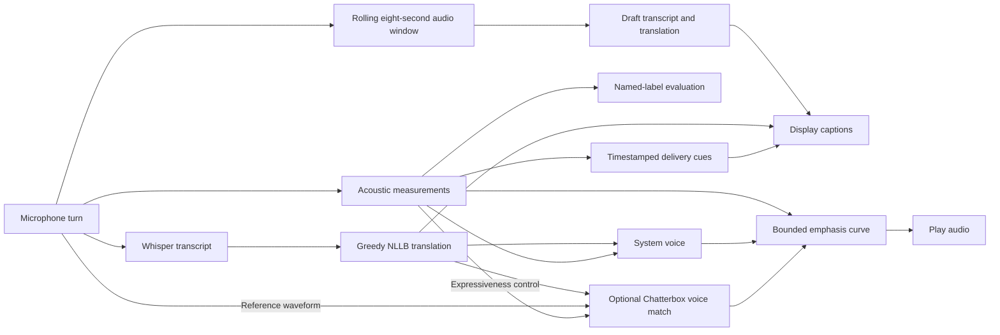

# Voice-only emotion model

The acoustic classifier uses relative pitch, energy changes, voicing, pause density, and rhythm. It receives the original 16 kHz waveform and computes 14 features. The app can report observable vocal cues from the recording. A separate display rule governs named emotion estimates. Voice and text emotion analysis have separate paths.

The bundled model is a regularized multinomial logistic classifier trained on the audio-only speech subset of RAVDESS. Steven R. Livingstone and Frank A. Russo recorded 24 actors reading two statements across eight emotional deliveries. This makes it possible to vary delivery while keeping words fixed. Their corpus, and the bundled research weights derived from it, are distributed here under CC BY-NC-SA 4.0. The audio files themselves are downloaded separately. [RAVDESS dataset and license](https://zenodo.org/records/1188976) · [Dataset paper](https://doi.org/10.1371/journal.pone.0196391)

## Reproduce the evaluation

Download `Audio_Speech_Actors_01-24.zip` from Zenodo. The published MD5 is `bc696df654c87fed845eb13823edef8a`. The optional German stress test uses `emodb.zip` version 1.3.0 with MD5 `9d21362dbc5676ef3ab4745d83ced0db`. Install the project requirements and run from the repository root. [Berlin EmoDB archive](https://zenodo.org/records/7447302)

```sh
python -m study.train_prosody /path/to/Audio_Speech_Actors_01-24.zip pragmatics/prosody_model.json
python -m study.voice_eval /path/to/Audio_Speech_Actors_01-24.zip --emodb /path/to/emodb.zip
```

The split is by actor. Four actors are reserved for development, four for testing, and sixteen for training. Each clip contributes a near-onset two-second window and a full version. Feature scaling is fit on training actors only. The previous display policy used a 0.35 raw-score threshold and a 0.10 lead over the runner-up. Scores are uncalibrated.

| Previous display rule | Labels returned | Correct among scored labels | Correct “disgust” labels | False “disgust” among other clips |
|---|---:|---:|---:|---:|
| RAVDESS full English clips | 121 / 240 | 72 / 121 | 14 / 28 | 14 / 208 |
| RAVDESS two-second English clips | 113 / 240 | 63 / 113 | 9 / 18 | 9 / 208 |
| Berlin EmoDB full German clips | 260 / 535 | 79 / 241 | 0 / 15 | 15 / 489 |

Correctness refers to the dataset's acted label. The German stress test is outside the training language and includes all ten corpus speakers. Its scored-label column excludes boredom, which is outside the classifier's label inventory. The old rule identified both sides of zero of the 16 English neutral–disgust pairs with the same words, speaker, and take number at normal intensity. The new rule requires each label to reach 80% precision on at least 12 full development clips from at least three speakers and to lead the runner-up by 0.15. The floor is chosen for each label from scores of 0.40 through 0.85 in 0.05 steps. Every label fell short of this screen. The current rule therefore abstains on named emotions, with zero categorical coverage on both benchmarks. The audio cues and playback controls use separate measurements.

## Benchmarking on ordinary speech

- Collect matched recordings from consenting speakers. Have each speaker repeat one sentence with steady, excited, irritated, and genuinely disgusted delivery, then record unscripted speech with ordinary pauses and ambiguous affect. Record the speaker's intended delivery separately from audio-only listener judgments. Include a neutral and ambiguous option, short utterances, multiple microphones, and held-out speakers in each language.
- Use CREMA-D for an independent acted-English benchmark with audio-only listener ratings and MSP-Podcast for more natural speech with perceived valence and activation annotations. Freeze thresholds before evaluating an external corpus and report corpus, language, and label mapping explicitly. [CREMA-D dataset](https://github.com/CheyneyComputerScience/CREMA-D) · [MSP-Podcast corpus](https://www.lab-msp.com/MSP/MSP-Podcast.html)
- Report per-label precision and recall, the proportion of other clips called disgust, the neutral false-alarm rate, coverage and accuracy together, and the fraction of matched pairs correctly distinguished. Report speaker-level confidence intervals and inter-rater agreement. Use a separate calibration split for any probability calibration and report reliability bins and Brier scores on the test split.

Google also describes live translation that preserves aspects of source delivery. The experiment here is to measure explicit voice-only emotion labels separately from translation quality. [Google Live Translate announcement](https://blog.google/innovation-and-ai/models-and-research/gemini-models/gemini-live-3-5-translate/)

## Live playback evaluation



Playback uses a bounded mapping from source pitch variation, pitch movement and energy rhythm to system voice pace and pitch or Chatterbox expressiveness. Both paths apply a smooth emphasis curve estimated from median levels in voiced sections. It is centered per recording, limited to ±3 dB, and aligned by relative progress through the audible output. Pacing and emphasis can land on different words in the target language. Explicit spoken-tone presets use fixed synthesis controls and keep some of the measured emphasis curve.

A regularized linear ranker was fit on 446 matched normal-versus-strong RAVDESS pairs from the training actors. The pairs hold speaker, sentence, emotion, and take number fixed. The score guides the strength of Chatterbox expressiveness and emphasis for English source speech. On 111 usable held-out pairs from four speakers, the heuristic alone ranked the strong take higher in 67 pairs, the learned score in 95, and the blended Chatterbox control in 90. The checks measure agreement with acted intensity and are exploratory. Bilingual listening tests are needed to estimate how the translated audio is perceived.

The optional profile uses a separate recording to supply the Chatterbox speaker embeddings in T3 and S3Gen. The current turn supplies acoustic prompt tokens and features. The profile applies to the selected speaking language when the T3 speaker cosine similarity reaches 0.75. Otherwise synthesis uses the current turn's reference. This threshold was screened with synthetic Mac voices. Study false acceptance and rejection across accents, microphones, expressive delivery, and short turns before relying on it. The profile is an experimental conditioning reference. A modest tempo adjustment and the existing emphasis curve apply to personalized output.

A Chrome smoke test recorded a nine-second sample from a simulated microphone and released the microphone automatically. The local app used that profile for calm and animated versions of the same English sentence and played the Spanish output. Clearing the sample removed it from subsequent requests. A separate engine check used the live reference for a different synthetic speaker. These checks cover recording, routing, and synthesis. Speaker resemblance and perceived delivery need listener ratings.

For the playback study, keep the translated text identical across synthesis arms and cross source and target languages. Randomize and blind playback of a fixed system voice, the expressive system voice, a reference-conditioned Chatterbox voice with constant expressiveness, and the app's reference-conditioned voice with acoustic control. Add an ablation with the emphasis curve disabled to isolate its contribution. Ask bilingual raters which output better preserves the audible delivery, then score activation, perceived emotion, speaker likeness, intelligibility, and adequacy separately. Record failed or substituted outputs. Report agreement and speaker-level uncertainty intervals by language and condition. The voice reference may contain language-specific accents, and the model can introduce pauses, pronunciation errors or words.

Compare single-turn voice matching with profile-conditioned matching on the same source turns and translations. Include pairs with identical wording but different emphasis or question intonation. Ask listeners who know the speaker to rate speaker likeness, and ask bilingual listeners to rate delivery and meaning independently. Include difficult cases where two people speak the same language. Record profile use, fallback, and additional playback latency. DeepL documents a rolling session reference in Speaker Match, which makes it a relevant comparison for a future blinded evaluation. [DeepL Speaker Match](https://support.deepl.com/hc/en-us/articles/30116563451292-About-speaker-match)

Time each condition from the last voiced frame to the request, the first displayed text, and the first audible output. Record model startup, recognition, translation and synthesis separately. Report cold and warm p50 and p95 on the same hardware by clip length. Compare greedy decoding and 8-bit NLLB with the original precision four-beam baseline for adequacy. A smoke test verifies that audio is generated. Listener ratings are needed to establish whether it sounds like the speaker or conveys their delivery.

In a local Chrome smoke check on a 16 GB Apple Silicon Mac, a synthetic recording of “Thank you for helping me” triggered English-to-Spanish translation after about one second of quiet. The expressive run displayed text at 2.96 seconds and played at 3.10 seconds after the last voiced frame. The voice-matching run displayed text at 1.44 seconds and played at 4.05 seconds. A roughly 30-second recording played in expressive mode 6.17 seconds after the last voiced frame. Whisper misheard words in that recording, including “pears.” Each value is one observation on the running app. The study should repeat both conditions in randomized order to estimate the typical delay and its spread.

In a later Chrome smoke check of the two-way interpreter on the same Mac, a simulated microphone played three short turns in English, Spanish, and English. All switched direction automatically. Playback began 1.32–1.55 seconds after the last voiced frame, including the 0.75-second quiet setting. With the translated text “¡Muchas suerte!” fixed, the system voice produced 0.82 seconds of audio with the Excited preset and 1.29 seconds with Calm. These observations check direction, timing, and the effect of the controls on generated audio. Perceived tone requires blinded listening tests.

## Caption delivery cues

The detector compares successive 0.8-second windows within a turn when each has enough periodic, voiced frames. It measures shifts in median pitch, median microphone level, and the rate of peaks in the smoothed loudness envelope. Current thresholds are 3 semitones, 6 dB, and 2.5 envelope peaks per second. The strongest eight changes are returned in time order with descriptions in the caption language. The cues can reflect emphasis, lexical tone, changes in microphone distance, or a change of speaker. Live conversation shows acoustic cues for all twelve configured languages.

For caption evaluation, recruit deaf and hard-of-hearing readers and bilingual reviewers. Compare text-only captions with otherwise identical captions that show vocal cues. Include same-word recordings with different delivery, neutral turns, tonal languages, speaker handoffs, background noise, and changing microphone distance. Have raters mark audible changes and time ranges before measuring cue precision, missed cues, timestamp error, and reader comprehension. Measure draft delay from speech onset, revisions per turn, time to final captions, and word or character error rate by language. Include checks for reading order, Arabic directionality, and keyboard use. Synthetic checks establish software behavior. Reader validation and generalization to spontaneous speech remain open. [W3C guidance on live captions](https://www.w3.org/WAI/WCAG22/Understanding/captions-live.html)

In a Chrome check using a 13-second synthetic English microphone signal and the one-second pause setting, the first Arabic caption draft appeared 3.33 seconds after speech began. Four draft windows were requested during the turn. The final caption used right-to-left text and included localized vocal cues. The same setup verified keyboard caption visibility and silent playback in captions-only mode. The local model checks exercised recognition, translation to and from English, and audio generation in all twelve configured languages.
